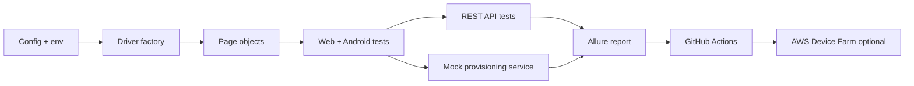

# qa-automation-framework

A reusable Python automation framework covering mobile, web, API, provisioning, load, and reporting workflows.

## Architecture



## Step 1 implemented

- Scaffolded the project layout and Python dependencies.
- Added central configuration and logger modules.
- Added marker definitions for smoke/regression/mobile/web/api/provisioning.
- Created reusable page-object base classes and explicit waits.
- Included the repo-level pytest configuration and environment template.

## How to run

```bash
python -m pip install -r requirements.txt
python -m playwright install
pytest -m "smoke or api" -q
```

## Test count table

| Suite | Count | Status |
|---|---:|---|
| Mobile | TODO | planned |
| Web | TODO | planned |
| API | TODO | planned |
| Provisioning | TODO | planned |
| Load | TODO | planned |
| Total | TODO | planned |

## Notes

- Real BLE/Wi-Fi hardware is intentionally mocked in the provisioning service.
- AWS Device Farm guidance is optional and is not run unless credits and credentials are available.
- All metrics remain TODO until the project is executed in CI or locally.
